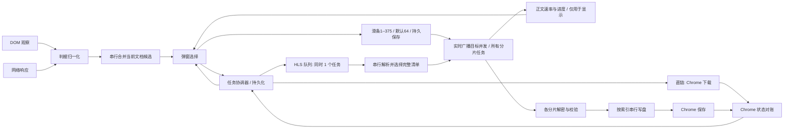
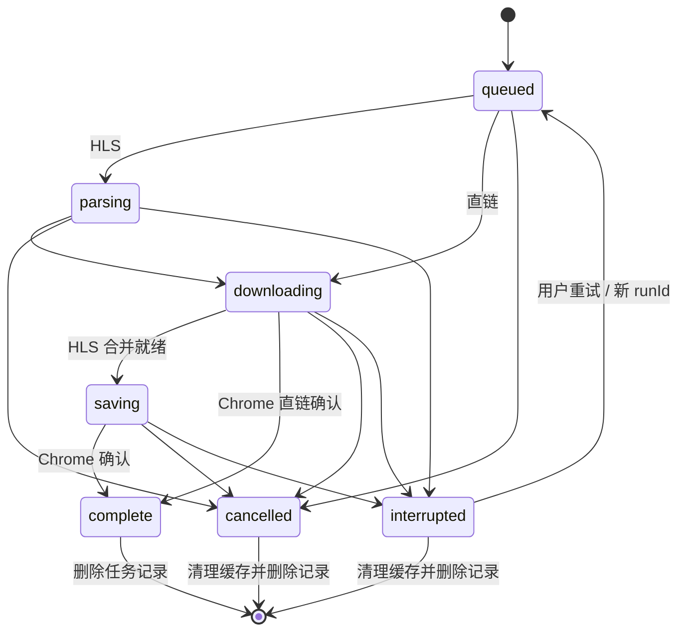

# 架构与执行关系

## 模块职责

| 模块 | 输入 → 输出 | 可以做什么 |
|---|---|---|
| `content.js` | 播放器/当前线路 DOM → 观察消息 | 发现、播放状态；不采集视频画面，不创建下载 |
| `domain/media.js` | URL + 多次观察 → 类型、后缀、判据 | 纯函数；不访问 Chrome、DOM、网络 |
| `background.js` | DOM/网络事件 → 当前页候选 | 恢复后串行合并，隔离旧文档，session 持久化 |
| `engine/job-state.js` | 状态、runId、revision → 是否接纳/阶段说明 | 纯协议与资源上限 |
| `download-manager.js` | 可信弹窗命令、执行器消息、Chrome 事件 → 任务记录 | 创建去重、下载 API、持久化、恢复对账；唯一任务元数据写入者 |
| `offscreen.js` | HLS 任务 → 进度/缓存/保存请求 | 一个 HLS 执行任务，其余排队；取消与清理 |
| `hls-core.js` | 清单/注入的 fetch → 计划/资源字节 | 解析、解密、有限重试、正文观测、同来源 Retry-After |
| `engine/transfer-metrics.js` | 正文到达/请求结束 → 显示速率与请求计数 | 纯被动测量，不计算或更改并发 |
| `engine/segment-scheduler.js` | 计划/用户选择的并发 → 有序输出 | 同时最多所选数量的分片任务，重试仍占本任务槽；完成即补位 |
| `engine/transfer-buffer.js` | 已声明/实际正文大小 → 可读取额度 | 双份 payload 预留、当前头片保护、取消唤醒 |
| `segment-cache.js` | 分片身份/字节 → OPFS 缓存 | 哈希校验、计划指纹、续传与清理 |
| `ui/format.js`、`ui/capture.js`、`ui/explain.js` | 事实 → 展示文案 | 纯显示规则、状态解释、脱敏路径 |
| `popup.js` | UI 事件/任务快照 → 控件更新 | 不执行 HLS，不因关闭弹窗取消任务 |

经典本地 scripts 负责加载，避免为小扩展引入构建框架；纯模块同时导出 CommonJS，Node 测试执行生产代码。Chrome API 与文件 IO 保留在边界模块。

## 冷启动与重新识别的依赖

旧版打开弹窗先等下载记录和偏好，再识别来源；右上角刷新仅重复读取后台缓存。页面又在发送消息前去重，失败后可能没有补报机会。2.2.1按实际依赖拆分：

| 事件 | 执行关系 | 原因 |
|---|---|---|
| 任务对账、偏好读取、查询当前页并扫描 | 三路独立并行 | 来源不依赖下载记录或滑块值，迟到默认页签不能覆盖用户切页 |
| 后台session恢复 → 捕获状态修改 | 串行 | 防止晚到的旧缓存覆盖新来源 |
| 各可访问frame的本地脚本注入 | 独立；不持有捕获队列 | 脚本需要等待报告ACK，持有该队列再等待脚本会自锁 |
| 同一文档的播放/身份确认 → 标题确认 → 媒体报告 | 前置确认串行，独立媒体报告并行 | 旧代次不能给新资源贴标签，文件名不能先套用旧标题 |
| 扫描报告ACK → 最终列表快照 | 串行 | 不把“开始扫描”误报成“已得到完整结果” |
| 两秒轮询/来源变更通知 | 只读getMedia | 避免重新注入和通知相互触发的循环 |

打开弹窗和手动刷新使用可信popup专属`refreshMedia`。scripting仅执行扩展包内的content.js，在已有HTTP(S)授权范围内扫描；不导航、刷新或控制播放器。单文档复用扫描实例，不重复增加MutationObserver或视频事件监听。每包固定采样时的token/generation，ACK成功才标记去重；失败、忽略、失效和超时不假装完成。新实例使用观察器激活时间，BFCache激活更换token，同实例强制扫描保留身份。

同tab重叠刷新共享在途扫描，导航同步使旧扫描失效；新页面可以建立自己的扫描。全frame失败可重试主frame，部分成功明确提示；失败不清空已有网络证据。脚本ACK和后台扫描都有有限等待，退出后可以显式重试。已确认旧documentId的返回结果仅清理旧文档上下文，共享URL的新文档引用保留。极端情况下，后台从未见过的旧文档在导航后才首次报告，且没有注入结果证明其旧身份，仍无法仅靠当前事件信息严格归因；不以猜测时间阈值删除资源。

Chrome的内容脚本重载条件与scripting Promise结果契约分别见[官方重载说明](https://developer.chrome.com/docs/extensions/get-started/tutorial/hello-world#reload-the-extension)和[Scripting API](https://developer.chrome.com/docs/extensions/reference/api/scripting)。

## 为什么这样安排并行与串行

- **并行有收益**：DOM 与网络可独立观察；同一 HLS 的分片网络等待可重叠。网络任务完成就补充新任务，不必等待同批最慢分片写完；按序写盘独立推进。最多前瞻512片，并受字节预算约束，不无限积累后续分片。
- **串行保护含义**：清单依赖解析、同一文件写入、任务状态持久化按顺序进行。分片完成顺序可以不同，文件顺序必须与清单一致。
- **HLS 任务互斥**：同时仅 1 个 HLS 任务占用合并和保存资源，避免大视频争抢 OPFS 与缓存；待处理任务有明确排队状态。直链由 Chrome 独立管理，不承诺其内部连接数。
- **并行选择**：下载任务页一个1–375滑动条，默认64，左稳右急。偏好即时提交给worker串行持久化，随后广播给offscreen所有活动及排队任务。执行器通过get/subscribe控制对象通知调度器：升高立即补位，降低只约束新分片准入，已在途及内部重试保留原任务槽。新任务、重试和执行器创建期间的设置变化都采用最新版本。视频来源页不显示下载偏好。没有自动并发算法，速度和ETA也不改变这个值。
- **显示与事实**：正文到达就计量速度，不必等完整分片；失败尝试与解密/正文校验失败不虚增有效速率。实际请求数与选择的并发数不同：缓存、重试等待、剩余片数和浏览器/缓冲调度都可能让请求数较少。纯显示模块不反向控制调度器。
- **背压与重试**：默认192MiB为应用payload预留预算，计入读取/解密的双份拷贝余量，为当前及未来所需头片保留完成空间。可信未压缩Content-Length可缩小保护；缺长度时逐块增长。浏览器内部缓冲、单次reader交付超过预留的块、MAP、OPFS及操作系统缓存不在此预算内，不能称浏览器总内存上限。缓冲不足只等待空位，不改用户选值。每片重试占同一任务槽，不在所选并发外另起重试。Retry-After作用于同来源新请求和重试，等待完整期限且可取消；本地缓冲等待不计为网络超时。
- **资源边界**：单资源正文上限64MiB、清单4MiB。超过时明确失败；已知未压缩正文与声明长度不符时失败重试，不截断内容。缓存写入失败立即取消网络，网络失败时尽量结算已在途且可缓存的分片。

## 状态与恢复

每次尝试有独立 `runId`，进度快照携带递增 `revision`。旧尝试、过时进度、终态后的迟到消息不能覆盖新状态。重试创建新尝试，不把旧终态原地伪装成进度回退。Chrome 返回 downloadId 仅代表接单，不能代表完成。

并发偏好与独立递增的 `concurrencyRevision` 一起写入local；它与任务进度revision分开。offscreen只接纳更新版本，同版本同值是无通知的幂等操作，旧runJob与旧控制消息不能恢复旧值。worker对账时重发最新偏好，修复挂起恢复或消息丢失；已保存但实时下发未获确认时，UI明确显示待应用并可重试。旧并发版本的进度可继续贡献字节和实际在途请求数，但不能覆盖新目标值。调度器结束时解除订阅，写盘始终按清单索引串行。

页面候选用 `storage.session`，任务与设置用 `storage.local`；OPFS 保留已验证字节。worker 恢复先读取状态，再与 offscreen/Chrome 下载记录对账。浏览器关闭后不会继续传输；重启后可能显示可继续的中断任务，由用户继续。不要把关闭弹窗与关闭浏览器混为一谈。

Chrome 下载创建与本地持久化不是同一事务。若进程恰好在 Chrome 接单后、保存 downloadId 前崩溃，无法保证严格 exactly-once；不无条件重放创建命令。此时需查看 Chrome 下载记录，避免重复保存。

预计剩余时间由执行器提供：HLS使用12秒窗口，至少3个网络完成样本且运行2秒后才估算；缓存只减少待取片数、不计作网络样本。预计时间会随分片大小、重试和来源响应波动，不包含最终保存等待。直链采用Chrome的estimatedEndTime。保存、终态与样本不足时不显示虚假的0秒倒计时。

分片并发是唯一可编辑偏好。每次输入立即交给worker，worker串行执行读、合并、写；popup仅用revision保护视图，不能独占未发送的写入队列。视频只提交不含目录的安全文件名与saveAs:false，落在Chrome默认下载目录；旧子文件夹/询问保存位置不参与新下载和继续下载。文件名相对默认目录的约束见 [Chrome downloads API](https://developer.chrome.com/docs/extensions/reference/api/downloads#type-DownloadOptions)。输出文件显式声明TS/MP4 MIME，OPFS通过Blob切片引用已有文件，不将大文件读回JavaScript内存。

2.1.3移除网页信息栏、网页标题播报、来源搜索及画面抓拍。内容脚本不再创建canvas、监听截图时机或上报图片；后台不再缓存/发送图片，恢复时清除旧截图数据。网页标题仅用于视频文件命名。frameId、父子框架和文档身份仍用于发现隔离，与图片帧无关。2.2.1右上角重新读取按钮会重新扫描当前可访问的页面框架并返回已确认候选，不启动下载。

取消与删除分工明确：活动任务先停止传输并确认资源结束；终态任务才可removeJob。删除清理临时缓存和扩展记录，不调用Chrome的erase/removeFile，不删除已保存视频。删除与重试、清缓存、创建、保存互斥；缓存清理或权威持久化失败时保留可重试记录。local任务数组是恢复权威，包括空数组；session仅用于旧版本缺失local时迁移，避免镜像旧数据让已删记录复活。

## 数据与信任边界

来源由真实 MIME、DOM 视频证据、后缀与线路提示共同判断；强证据可修正早期猜测。去重保留 query 参数，显示路径时隐藏 query/hash。页面报告的文字用 textContent 呈现。创建/取消/设置只接受本扩展弹窗，保存代理只接受本扩展 offscreen；网页脚本不能直接命令下载。

模块状态变化必须同时解释三件事：观察到什么、采取了什么动作、还没有确认什么。状态文案不是另一个独立状态机，始终从事实字段派生。
